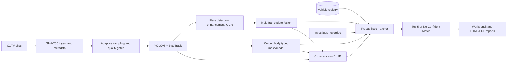

# Vehicle-Tracer

Vehicle-Tracer turns blurry, occluded CCTV footage into a ranked, explainable shortlist of possible vehicles from a registry. It never invents an unreadable plate character, and it returns **No Confident Match** when the evidence does not support a result.

Results are investigative leads. A shortlist does not establish a vehicle's or owner's identity and must be verified independently.

## Architecture



| Layer | Technology |
| --- | --- |
| API | FastAPI, Pydantic v2, Server-Sent Events |
| Storage | SQLite in WAL mode through SQLAlchemy 2, swappable with `DATABASE_URL` |
| Detection and tracking | Ultralytics YOLOv8n with ByteTrack |
| Plate OCR | FastALPR ONNX models, with automatic EasyOCR fallback |
| Attributes and Re-ID | OpenCLIP ViT-B-32, CIELAB k-means, HSV histograms |
| Reports | Jinja2 HTML, WeasyPrint PDF, with automatic ReportLab fallback |
| Frontend | React 18, TypeScript, Vite, Tailwind CSS |

## Quick start

Requires Python 3.10+ and Node 20+.

```bash
cd backend
python3 -m venv .venv
.venv/bin/pip install -r requirements.txt
.venv/bin/python scripts/download_models.py
.venv/bin/python scripts/generate_demo_clip.py
.venv/bin/uvicorn app.main:app --host 127.0.0.1 --port 8000
```

In a second terminal:

```bash
cd frontend
npm ci
npm run dev
```

Open <http://127.0.0.1:5173>. The first model download needs internet access and is roughly 600 MB. Later runs work offline.

### Live demo

1. Create a case and drop in `backend/demo_clips/camera_a_gate.mp4` and `camera_b_junction.mp4`.
2. Ingest them, then select **Run analysis**.
3. Camera A reads only `MH14GT7`, and Camera B reads only `4GT7319`. The hidden characters stay unknown.
4. Open **Cross-camera trace** to see both partial reads fused into `MH14GT7319`.
5. Open **Vehicle inspector**, correct a slot, and watch the shortlist re-rank with an audit entry.
6. In **Registry and sandbox**, try `ZZ99QQ0000` to see an explicit No Confident Match.
7. Export the HTML or PDF report.

## Plate fusion

Reads for a track are cleaned, then aligned progressively with semi-global Needleman-Wunsch so shifted partial reads land in the correct slots. Each frame's vote at slot $i$ is:

$$w_f = \text{ocr\_conf}_{f,i} \times \text{norm\_sharpness}_f \times \text{norm\_plate\_area}_f$$

The fused confidence of the winning character $c$ is:

$$\text{conf}_i = P_i(c) \times \Bigl(1 - \prod_{f \in \text{support}(c)} (1 - \text{ocr\_conf}_{f,i})\Bigr)$$

A slot is emitted as `?` when $\text{conf}_i < 0.55$, or when a single frame supports it with confidence below `0.78`. Runner-up characters are kept as evidence for the matcher and are never written into the plate.

## Matching

For a registry plate, each known slot contributes:

| Comparison | Contribution |
| --- | --- |
| Exact match | $+1.0 \times c$ |
| OCR-confusable pair | $+0.65 \times c$, plus a runner-up bonus |
| Unknown `?` | $0$, while lowering coverage |
| Low-confidence mismatch | $-0.40 \times c$ |
| Mismatch with $c \ge 0.80$ | $-1.2 \times c$ |

$$S_\text{plate} = \text{clamp}\Bigl(\frac{\sum \text{contributions}}{\sum c}\Bigr) \times \gamma, \qquad \gamma = \frac{\text{known chars}}{\text{plate length}}$$

| Plate readability | Plate | Body | Colour | Make/model | Cap |
| --- | --- | --- | --- | --- | --- |
| 6+ known characters | 0.62 | 0.15 | 0.13 | 0.10 | none |
| 3 to 5 known characters | 0.48 | 0.22 | 0.18 | 0.12 | none |
| 0 to 2 known characters | 0.20 | 0.35 | 0.27 | 0.18 | 65% |

Signals with no evidence are removed and their weight is redistributed. A high-confidence body contradiction multiplies the score by `0.25`.

The matcher returns `NO_CONFIDENT_MATCH` when any of these is true:

- The top candidate's confidence is below 45%.
- At least 5 high-confidence characters were read and the top candidate has 3 or more hard contradictions.
- No registry vehicle is body-compatible.
- At most 2 characters are readable and 6 or more vehicles are effectively tied.

## Evaluation

```bash
cd backend
.venv/bin/python -m pytest
.venv/bin/python scripts/evaluate_matcher.py --seed 7
```

Mean over five seeds (7, 42, 99, 101, 2026), 100 cases each:

| Top-1 | Top-5 recall | MRR | No-match precision | No-match recall | Mean match time |
| --- | --- | --- | --- | --- | --- |
| 98.3% | 99.8% | 0.989 | 99.0% | 99.0% | under 5 ms |

**This benchmark measures the matcher on simulated OCR evidence.** It does not measure detection or OCR accuracy on real CCTV footage.

## Known limitations

- End-to-end CV has been exercised on the generated demo clips, not on a labelled real-world CCTV dataset.
- YOLOv8 uses COCO classes, so auto-rickshaws depend on the OpenCLIP refinement.
- Zero-shot make/model recognition is approximate for visually similar vehicles.
- OCR confidence can be overconfident on heavily degraded plates.
- The API has no authentication. Add access control before any deployment beyond a local machine.
- The seeded registry and its owners are synthetic.

## Licensing

Ultralytics YOLO is distributed under AGPL-3.0 unless you hold an Ultralytics Enterprise License. Review this and the model licenses before distributing or commercializing the project.

## API

| Method | Endpoint | Purpose |
| --- | --- | --- |
| GET | `/api/health` | System, model, device and registry status |
| POST, GET | `/api/cases` | Create or list cases |
| GET | `/api/cases/{id}` | Case detail |
| POST | `/api/cases/{id}/clips` | Upload clips |
| POST | `/api/cases/{id}/analyze` | Start the pipeline |
| GET | `/api/cases/{id}/progress` | Live SSE progress |
| GET | `/api/cases/{id}/vehicles[/{vehicle_id}]` | Vehicles and evidence |
| POST | `/api/cases/{id}/vehicles/{vehicle_id}/override` | Investigator override and re-rank |
| GET | `/api/cases/{id}/report/html`, `/report/pdf` | Forensic reports |
| GET | `/api/registry` | Search the registry |
| POST | `/api/registry/upload` | Import CSV or JSON |
| POST | `/api/registry/match-test` | Matcher sandbox |
