<p align="center">
  
</p>

<p align="center">
  <strong>Turn CCTV footage into vehicle evidence an investigator can inspect, question and defend.</strong>
</p>

<p align="center">
  <a href="#quick-start">Quick start</a> ·
  <a href="#how-vitra-works">How it works</a> ·
  <a href="#inside-the-evidence-pipeline">Pipeline</a> ·
  <a href="#results">Results</a> ·
  <a href="#api-reference">API</a>
</p>

---

**VITRA** (Vehicle Identification & Trace Analytics, repository name `Vehicle-Tracer`) analyses CCTV clips to track vehicles, recover partial number plates across frames, estimate vehicle attributes, compare readable plates with a registry, and propose cross-camera links for a person to review.

Its core rule is simple: **VITRA never invents a plate character.** If the footage does not show a character, it stays `?`. If the evidence is too weak, VITRA returns **No confident match** and explains why.

> [!IMPORTANT]
> VITRA produces investigative leads. A result does not establish a vehicle's or owner's identity and must be verified independently. The bundled registry is **synthetic test data** with fictional people and plates.

## Contents

- [Why VITRA exists](#why-vitra-exists)
- [How VITRA works](#how-vitra-works)
- [Product tour](#product-tour)
- [Quick start](#quick-start)
- [Your first investigation](#your-first-investigation)
- [System architecture](#system-architecture)
- [Inside the evidence pipeline](#inside-the-evidence-pipeline)
- [Data model](#data-model)
- [Results](#results)
- [Reports and exports](#reports-and-exports)
- [Configuration](#configuration)
- [Sign-in and online deployment](#sign-in-and-online-deployment)
- [API reference](#api-reference)
- [Testing and evaluation](#testing-and-evaluation)
- [Known limitations](#known-limitations)
- [Licensing](#licensing)

## Why VITRA exists

| The problem | What VITRA does |
| --- | --- |
| **Plates are rarely whole.** Blur, glare and other vehicles hide characters. | Combines many frames per character and leaves anything unseen as `?`. |
| **Reviewing footage takes hours.** People replay clips to find one vehicle. | Tracks every vehicle automatically, so review starts with a list. |
| **Cameras are disconnected.** One vehicle appears in separate clips. | Proposes cross-camera links and shows the evidence for each one. |
| **OCR guesses can look like facts.** One wrong character can misdirect a case. | Shows each character's frames, confidence, alternatives and rejected reads. |
| **A no-match can mislead.** The registry may not contain that plate format. | Separates a genuine no-match from **no registry coverage**. |
| **Evidence gets challenged.** Results need a traceable origin. | Keeps hashes, raw crops and an audit log with every result. |

## How VITRA works

<p align="center">
  
</p>

| Stage | Question it answers | Main output |
| --- | --- | --- |
| **1. Ingest** | Is this evidence intact, and where did it come from? | SHA-256 hash, read-only clip, camera metadata |
| **2. Detect** | Which vehicles appear, and when? | Vehicle tracks with quality grades |
| **3. Recover** | Which plate characters does the footage really show? | Fused plate with per-character evidence |
| **4. Match** | Which registry records fit, if any can be searched? | Candidate, ambiguous, no match or no coverage |
| **5. Review** | What does a person confirm? | Investigator decisions, audit log and report |

## Product tour

| Screen | What you do there |
| --- | --- |
| **Landing page** | Learn what VITRA does through a scroll-animated walkthrough, then open the dashboard |
| **Dashboard** | See your workload, your recommended next step and anything needing attention |
| **Investigations** | Search and filter every case |
| **Case workspace** | Add clips, run analysis, filter tracks and follow live progress |
| **Vehicle inspector** | Examine the source frame, raw and enhanced crops, plate matrix and match reasons |
| **Cross-camera trace** | Review proposed links on a camera timeline, then confirm or reject them |
| **Reports** | Preview and download HTML, PDF, CSV and JSON outputs |
| **Registry** | Search records, check plate-format coverage, import data and test the matcher |

### Reading the dashboard

The dashboard is designed so a first-time user can act without training. Select **Take the tour** for a seven-step guide, or use the `i` icon beside any metric for a plain-language explanation.

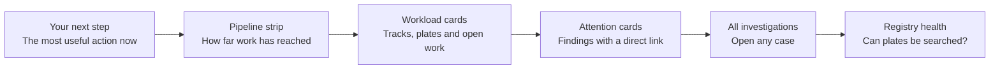

## Quick start

**Requirements:** Python 3.10+ and Node 20+.

### 1. Start the backend

```bash
cd backend
python3 -m venv .venv
.venv/bin/pip install -r requirements.txt
.venv/bin/python scripts/download_models.py
.venv/bin/uvicorn app.main:app --host 127.0.0.1 --port 8000
```

`download_models.py` needs internet access once and fetches roughly 700 MB. VITRA never downloads weights at startup. If required weights are missing, analysis stops with the exact install command instead of producing substitute output.

### 2. Start the frontend

In a second terminal:

```bash
cd frontend
npm ci
npm run dev
```

Open <http://127.0.0.1:5173>.

### 3. Load the labelled demo (optional)

In a third terminal, while the API is running:

```bash
cd backend
.venv/bin/python scripts/generate_demo_clip.py
.venv/bin/python scripts/create_demo_case.py
```

Every demo frame has a burned-in `SYNTHETIC TEST FIXTURE` banner.

| Demo camera | What it demonstrates | Expected outcome |
| --- | --- | --- |
| A Gate | Last three characters covered, and two registry plates still fit | Ambiguous |
| B Junction | First three characters covered | Plate-supported partial shortlist |
| C Depot | Ends covered in turn, and one middle character never visible | `?` preserved, plate-supported |
| D Ring Road | No capture time | Link shows temporal validation unavailable |
| E Toll | Clear plate that is not in the registry | Genuine no match |
| F Car Park | Plate too blurred to read | Unreadable, no characters invented |

## Your first investigation

1. Open the dashboard and select **New investigation**.
2. Add one or more CCTV clips (MP4, AVI, MOV, MKV, or a ZIP of frames).
3. Set each camera's **capture time** and **plate format**.
4. Read the preflight warnings, then select **Run analysis**.
5. Open a track in the **Vehicle inspector** and check its evidence.
6. Review any proposed links in **Cross-camera trace**.
7. Preview and export the report.

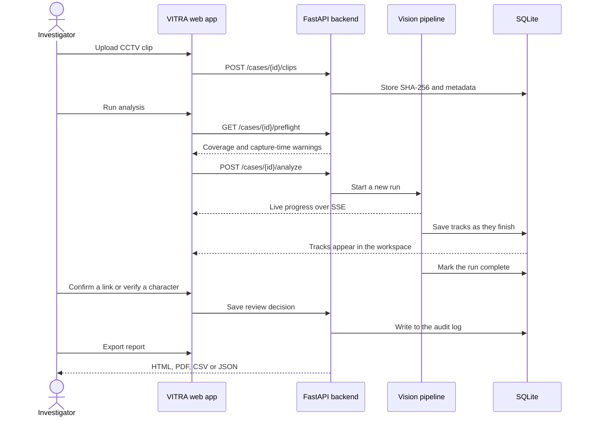

## System architecture

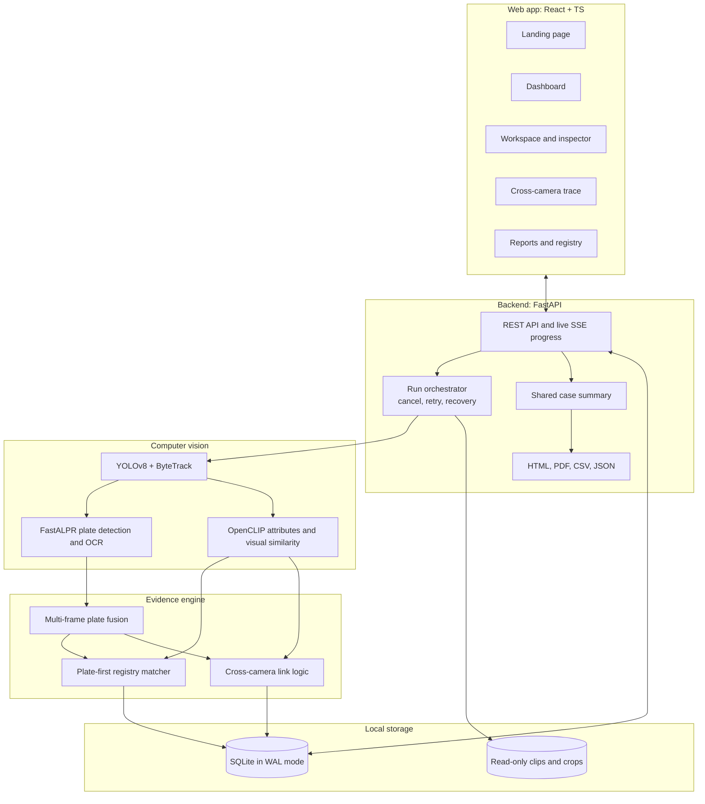

| Layer | Technology |
| --- | --- |
| Frontend | React 18, TypeScript, Vite, Tailwind CSS |
| API | FastAPI, Pydantic v2, Server-Sent Events |
| Storage | SQLite in WAL mode through SQLAlchemy 2, swappable with `DATABASE_URL` |
| Detection and tracking | YOLOv8s on GPU/MPS or YOLOv8n on CPU, ByteTrack, geometric and visual track stitching |
| Plate OCR | FastALPR ONNX models, with EasyOCR as a fallback when its weights are installed |
| Attributes and Re-ID | OpenCLIP ViT-B-32, CIELAB colour analysis, HSV histograms |
| Reports | Jinja2 HTML, WeasyPrint PDF, with automatic ReportLab fallback |

<details>
<summary><strong>Project structure</strong></summary>

```text
Vehicle-Tracer/
├── backend/
│   ├── app/
│   │   ├── api/          REST routes and shared labels
│   │   ├── cv/           Detection, tracking, OCR, fusion and Re-ID
│   │   ├── db/           Models, migrations and synthetic registry seed
│   │   ├── engine/       Plate-first matcher and schemas
│   │   ├── reports/      HTML and PDF report generation
│   │   └── services/     Run orchestration and case summaries
│   ├── scripts/          Model download, demo data and evaluation
│   └── tests/            Backend test suite
├── frontend/
│   └── src/
│       ├── api/          API client
│       ├── components/   Shared UI, logo, tour and landing sections
│       ├── lib/          Dashboard calculations
│       ├── pages/        Application screens
│       └── types/        TypeScript models
└── docs/
    ├── assets/           README charts and diagrams
    └── synthetic_pipeline_evaluation.json
```

</details>

## Inside the evidence pipeline

### 1. Ingest and chain of custody

Each uploaded clip is hashed with SHA-256 and stored read-only. Its hash is verified again before every analysis. Each run writes to a new artifact folder, so results from different runs do not overwrite each other.

Each camera has an explicit plate format. The format limits which registry rows can be compared, and **it never fills in a character**.

| Plate format | Use it for |
| --- | --- |
| Latin A-Z, 0-9 | General Latin plates, compared with every registry record |
| India RTO / BH | Indian plates |
| UK | UK plates |
| Non-Latin, digits only | Thai, Arabic and similar plates. Letters stay unknown, and only digits are used |

### 2. Detection and tracking

VITRA samples the full clip at up to 6 frames per second, with a limit of 720 frames. Within each sampling window, it compares up to three frames and keeps the most useful one. Blurry frames are flagged rather than discarded.

Tracks broken by occlusion are stitched back together. **No track is hidden to make results look cleaner.** Instead, each one is graded:

| A track is marked **Needs review** when | Threshold |
| --- | --- |
| It is very brief | Fewer than 6 sampled frames |
| The detector was unsure | Mean confidence below 0.40 |
| Its lower body was usually hidden | Occluded in at least 70% of frames |
| It was usually cut off by the frame edge | Truncated in at least 80% of frames |
| It may be a background object | Brief, with very little motion |
| Another track read the same full plate | Same plate in the same clip |

### 3. Image evidence

Plates are detected on the vehicle's lower body at native resolution. The raw crop keeps its source-frame coordinates, timestamp and hash.

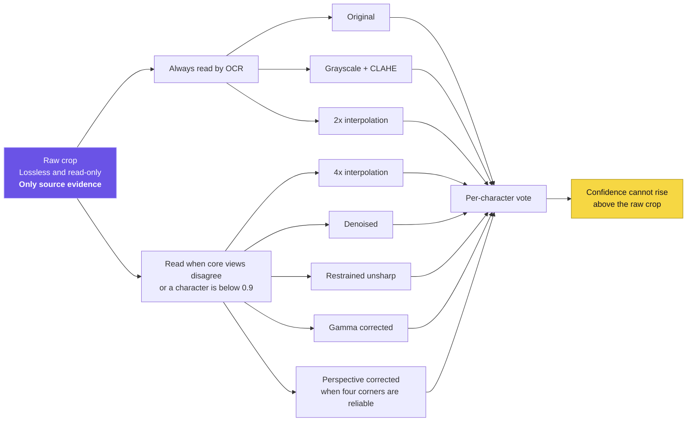

> [!NOTE]
> Enhancement helps a person inspect existing pixels. It cannot restore detail the camera did not capture, and VITRA does not use generative super-resolution.

To avoid wasted work, VITRA skips near-identical frames within one second, stops once five reads agree at high confidence, and stops early when the six best frames show no plate. Every skipped frame is counted on the track, so nothing is dropped silently.

### 4. Multi-frame plate recovery

<p align="center">
  
</p>

Reads are cleaned, seeded from the most corroborated frame, and aligned with semi-global Needleman-Wunsch. Reads that do not align are rejected with a stored reason.

Each frame's vote is weighted by OCR confidence, sharpness and plate size:

$$w_f = \text{ocr\_conf}_{f,i} \times \text{norm\_sharpness}_f \times \text{norm\_plate\_area}_f$$

The fused confidence for character $c$ at slot $i$ is:

$$\text{conf}_i = P_i(c) \times \Bigl(1 - \prod_{f \in \text{support}(c)} (1 - \text{ocr\_conf}_{f,i})\Bigr)$$

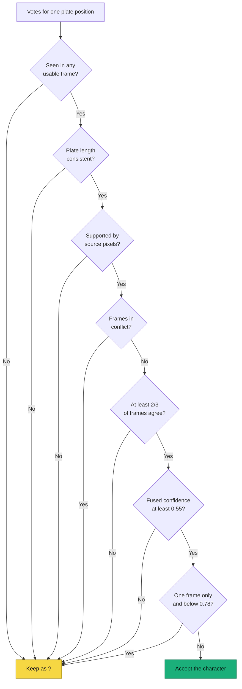

### 5. Registry matching

Plate evidence ranks vehicles first. Colour, body type and make/model can support a plate-based result, but **they can never promote a candidate on their own**.

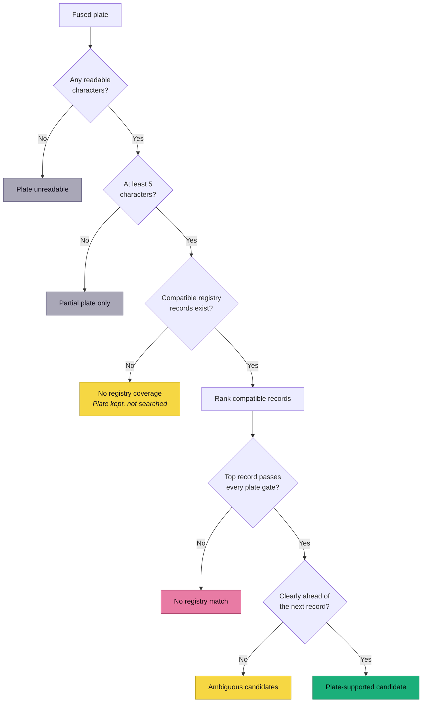

A vehicle is promoted only when **every** gate passes:

| Gate | Threshold |
| --- | --- |
| Readable plate characters | At least 5 |
| Characters agreeing with the registry plate | At least 5 |
| Exact character matches | At least 4 |
| Plate agreement | At least 0.70 |
| High-confidence contradictions | At most 1, and at most 15% of readable characters |
| Match score | At least 45 |
| Gap to the next plate | Score gap at least 5 and plate gap at least 0.02 |

The plate sub-score rewards agreement and scales with how much of the plate was read:

$$S_\text{plate} = \text{clamp}\Bigl(\frac{\sum \text{contributions}}{\sum c}\Bigr) \times \gamma, \qquad \gamma = \frac{\text{known chars}}{\text{plate length}}$$

<p align="center">
  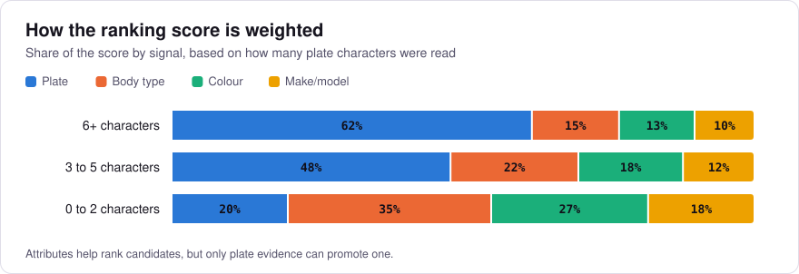
</p>

| Plate characters read | Plate | Body type | Colour | Make/model |
| --- | ---: | ---: | ---: | ---: |
| 6 or more | 62% | 15% | 13% | 10% |
| 3 to 5 | 48% | 22% | 18% | 12% |
| 0 to 2 | 20% | 35% | 27% | 18% |

> [!WARNING]
> The **match score is an uncalibrated ranking value, not a probability**. It should not be read as the likelihood that a match is correct.

### 6. Registry coverage

Before analysis, a preflight compares each camera's plate format with the active registry.

| Outcome | Meaning | What to do |
| --- | --- | --- |
| `NO_REGISTRY_MATCH` | A compatible registry was searched and no vehicle matched | Treat as a genuine no-match against that registry |
| `NO_REGISTRY_COVERAGE` | The plate was read, but the registry has no records in this format | Upload a compatible registry, then use **Re-match** |

**Re-match** compares stored OCR evidence with the updated registry and leaves that evidence unchanged. If a Latin-format camera mostly reads a plate family the registry lacks, VITRA flags a possible format gap, but it never changes the format itself.

<details>
<summary><strong>Registry import format</strong></summary>

Upload CSV or JSON from the Registry screen, up to 50,000 rows.

```csv
plate,make,model,body_type,colour,year,owner_name,owner_city,status
QA15ZZK,Fictional,Sedan,sedan,white,2021,Test Owner,Test City,ACTIVE
```

- `plate` (or `registration`) is required.
- `status` can be `ACTIVE`, `STOLEN_ALERT` or `EXPIRED`.
- **Merge** updates matching plates. **Replace all** deletes existing rows first.

</details>

### 7. Cross-camera links

VITRA only **proposes** links. Colour, body type, model and visual similarity can never create a link by themselves.

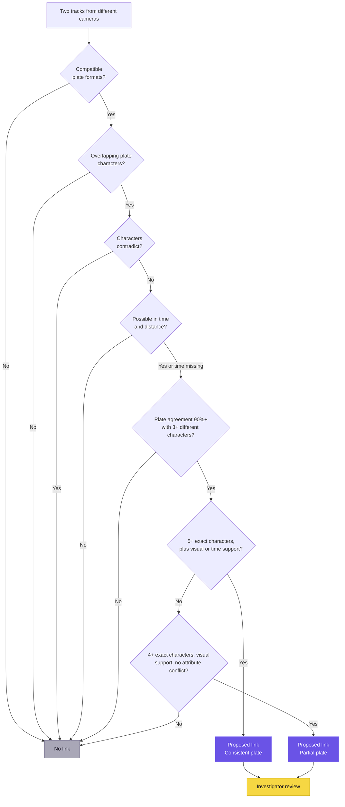

Sightings that overlap in time at different cameras, or would need a speed above 140 km/h, are blocked. A missing capture time is shown as **not validated**, never as a pass.

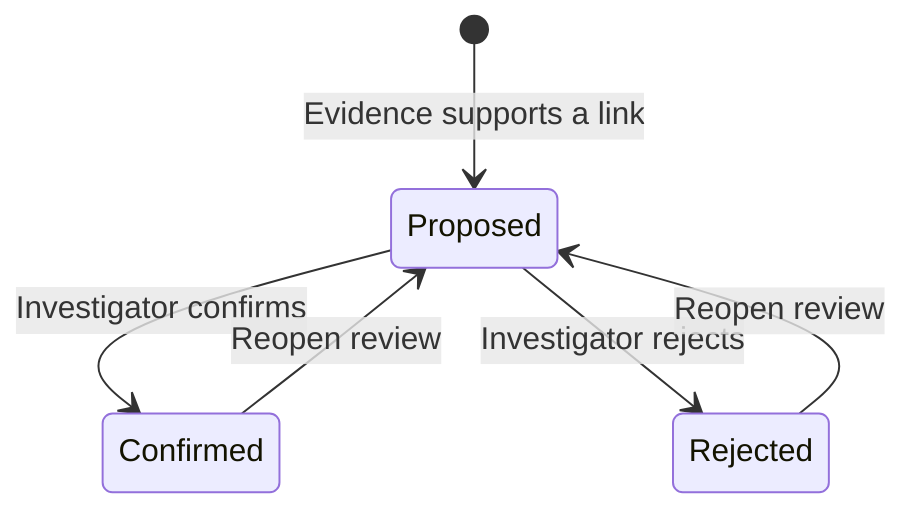

### 8. Analysis runs and failure recovery

Each run has its own ID. Tracks appear live, while reports keep using the last completed run until the new one finishes.

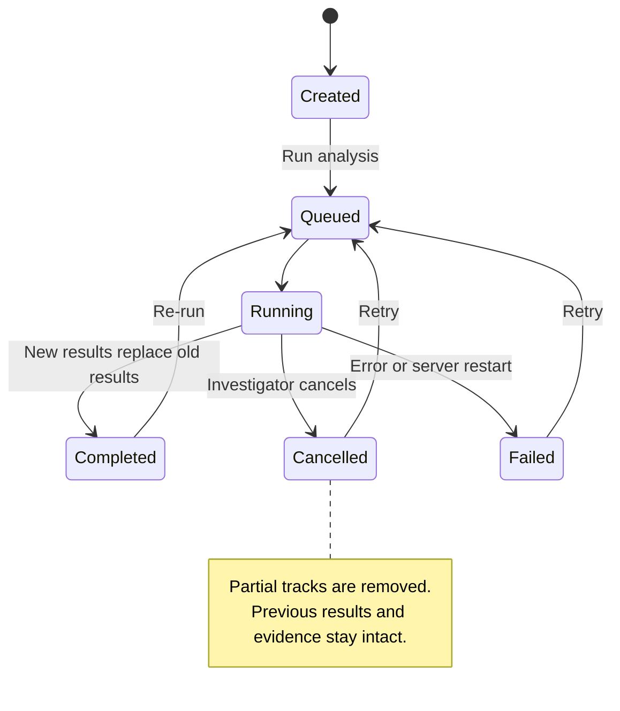

Track analysis uses a bounded worker pool of half the CPU cores, up to four workers.

## Data model

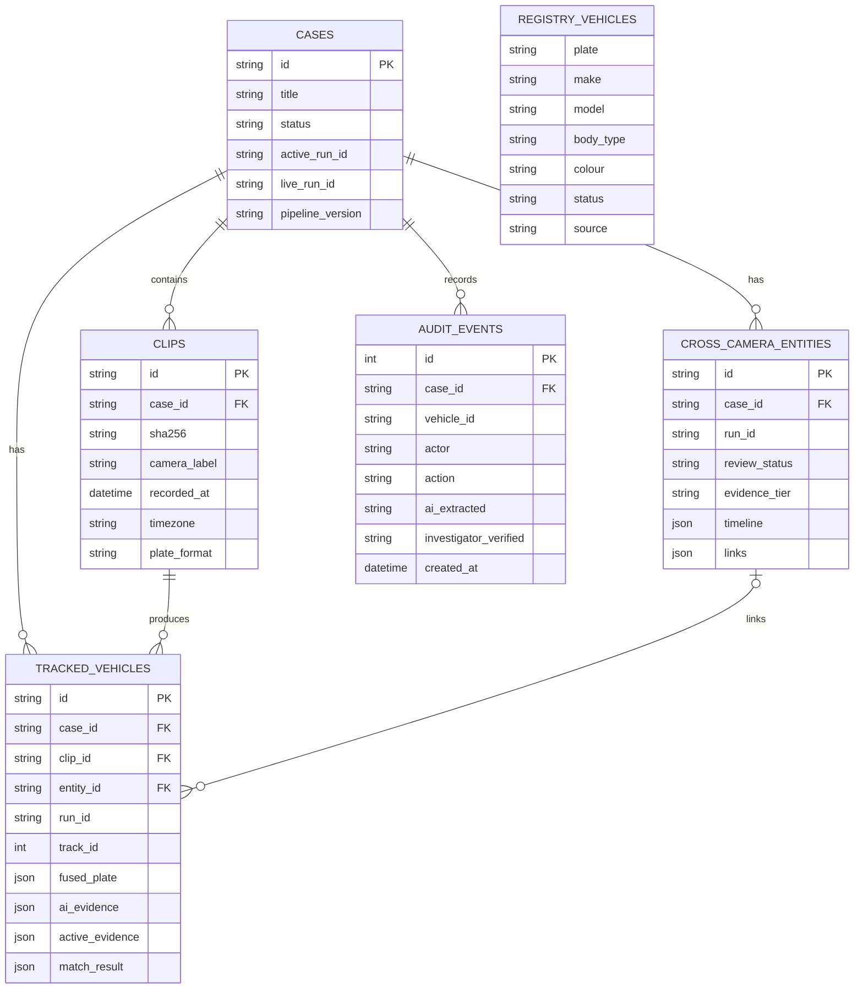

`ai_evidence` is never overwritten. An investigator's correction goes into `active_evidence` and is written to the audit log.

## Results

> [!CAUTION]
> These figures come from this project's labelled synthetic test set and one real test clip. **They are not a real-world accuracy claim.**

### Accuracy on labelled test data

The evaluation renders labelled synthetic videos and runs them through the real detector, tracker, OCR, fusion, matcher and link logic. It covers 66 single-sighting cases and 20 cross-camera sightings. Both releases were measured on the same seed, `20261128`, and decision thresholds were not tuned for it.

<p align="center">
  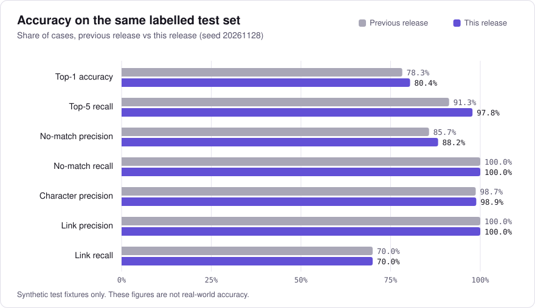
</p>

| Metric | Previous release | This release |
| --- | ---: | ---: |
| Top-1 accuracy (46 rankable cases) | 78.3% | **80.4%** |
| Top-5 recall | 91.3% | **97.8%** |
| Mean reciprocal rank | 0.848 | **0.882** |
| No-match precision | 85.7% | **88.2%** |
| No-match recall | 100% | 100% |
| Promoted results | 31, with 0 wrong | **32, with 0 wrong** |
| Emitted character precision | 98.7% (8 wrong of 632) | **98.9%** (7 wrong of 626) |
| Characters emitted on covered positions | 2 | 2 |
| Cross-camera link precision | 100% (7 of 7) | 100% (7 of 7) |
| Cross-camera link recall | 70% (7 of 10) | 70% (7 of 10) |

<p align="center">
  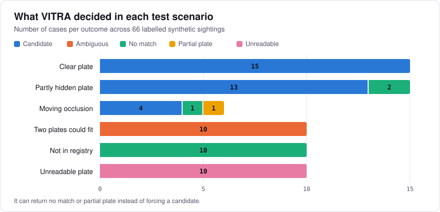
</p>

Full results are in [`docs/synthetic_pipeline_evaluation.json`](docs/synthetic_pipeline_evaluation.json).

The fixtures reuse one recoloured vehicle photo, which makes visual re-identification unusually hard and plate rendering unusually clean. The set still shows real failure modes: OCR occasionally emits a wrong character or a character on a covered position, and true links can be missed.

### Speed on a real clip

<p align="center">
  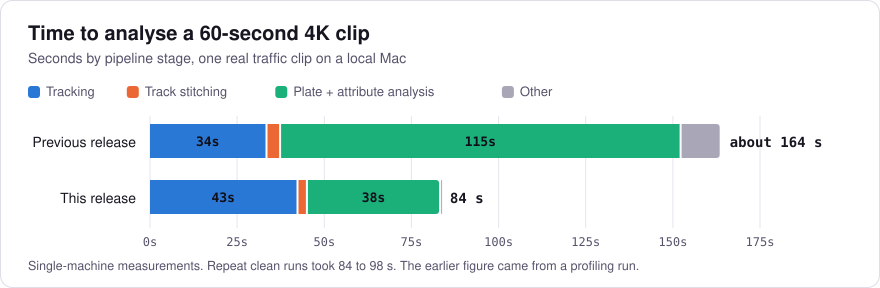
</p>

Most of the gain comes from reading plates on the vehicle region, skipping near-duplicate frames, stopping once a plate read is stable and analysing tracks in parallel. Tracking itself takes slightly longer because VITRA now compares more candidate frames.

### What one real clip produced

<p align="center">
  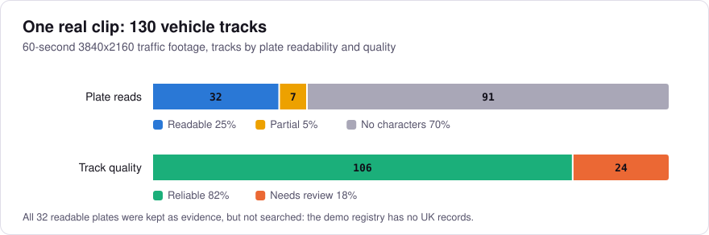
</p>

For 31 plates checked by eye in this clip, VITRA read **26 exactly**, kept **5 correct with `?`** for uncertain characters, and showed **0 wrong characters**. The two-thirds agreement rule was added after an earlier run on this clip misread one character, so this is a useful regression check rather than independent proof.

## Reports and exports

| Format | Best for | Includes |
| --- | --- | --- |
| **HTML** | Reading and sharing | Outcomes, coverage, evidence crops, per-character notes, rejected reads and audit log |
| **PDF** | Case files | The same findings in a printable layout, with an optional appendix |
| **CSV** | Spreadsheets | One row per track, with outcome, coverage, hashes and quality |
| **JSON** | Integrations | Summary, clips, tracks, per-character evidence and audit log |

Reports can cover a whole case or a single clip. All outputs use one shared summary, so their counts agree with the dashboard.

## Configuration

Every setting can be overridden with an environment variable or `backend/.env`.

| Variable | Default | Purpose |
| --- | --- | --- |
| `DATABASE_URL` | Local SQLite file | Database connection |
| `UPLOAD_DIR` | `backend/storage/uploads` | Original evidence |
| `ARTIFACT_DIR` | `backend/storage/artifacts` | Frames and crops |
| `MODEL_DIR` | `backend/storage/models` | Model weights |
| `DEVICE` | `auto` | `auto`, `cpu`, `mps` or `cuda` |
| `SAMPLE_FPS` | `6.0` | Frames sampled per second |
| `MAX_FRAMES_PER_CLIP` | `720` | Sampling limit per clip |
| `YOLO_MODEL` | `auto` | YOLOv8s on GPU/MPS, YOLOv8n on CPU |
| `YOLO_CONF` | `0.25` | Vehicle detection confidence |
| `TAU_CHAR` | `0.55` | Minimum fused character confidence |
| `SINGLE_FRAME_MIN_CONF` | `0.78` | Confidence needed from a single frame |
| `REGISTRY_SIZE` | `5000` | Synthetic registry seed size |
| `MAX_PLAUSIBLE_SPEED_KMH` | `140` | Travel speed limit for link checks |
| `ANALYSIS_WORKERS` | `0` | `0` uses half the CPU cores, up to 4 |
| `MAX_UPLOAD_MB` | `1024` | Maximum upload size |
| `AUTH_USERNAME` | `admin` | Sign-in username |
| `AUTH_PASSWORD` | empty | Sign-in password. Empty turns sign-in off |
| `SESSION_SECRET` | random per start | Key that signs session cookies |
| `SESSION_HOURS` | `12` | How long a sign-in lasts |
| `REQUIRE_AUTH` | `false` | Refuse to start without `AUTH_PASSWORD` |
| `COOKIE_SECURE` / `COOKIE_SAMESITE` | `false` / `lax` | Cookie flags. Set `true` / `none` behind HTTPS in an iframe |
| `FRONTEND_DIST` | not set | Folder of the built web app to serve from the API |

## Sign-in and online deployment

When `AUTH_PASSWORD` is set, every case, evidence, registry and report route requires sign-in. Only `/api/health` and the sign-in endpoints stay public.

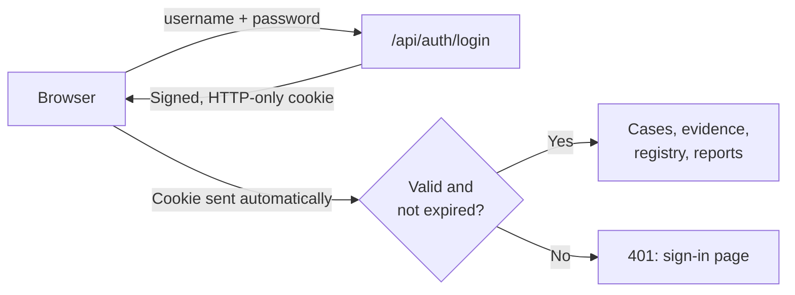

- Sessions are HMAC-signed cookies that page scripts cannot read.
- Five failed attempts lock that address out for five minutes.
- Write requests from other websites are rejected.
- Without a password, sign-in is off. Only run it like that on your own machine.

> [!WARNING]
> There is one shared investigator account. Anyone who knows the password sees every case, so share it only with people who should see the evidence.

### Free: serve from your own computer

`deploy/serve_public.sh` runs VITRA on this machine with sign-in on and gives it a public HTTPS address through a free tunnel. You don't need an account. It uses a Cloudflare quick tunnel when your network allows it, and otherwise Pinggy over the built-in `ssh` command.

```bash
deploy/serve_public.sh
```

The first run asks for a sign-in username and password and saves them to the git-ignored `deploy/.env.public`. The script then prints the public link.

| Tunnel | Free-plan limits |
| --- | --- |
| Cloudflare (`brew install cloudflared`) | Link changes on every start. Some networks block it |
| Pinggy | Link expires every 60 minutes and the script reconnects with a new one. Visitors see a one-time Pinggy warning page and click **Enter site**. The address contains your public IP number |
| localhost.run (`TUNNEL=localhostrun`) | Throttled to the point that the app takes minutes to load |

The site stays online only while the script runs and the computer is awake.

### Deploy to Hugging Face Spaces

Docker Spaces need a Hugging Face PRO subscription.


The root `Dockerfile` builds one container. It builds the web app, installs CPU-only PyTorch, bakes in the model weights and serves everything on port 7860 with sign-in required. A free Docker Space has 2 CPUs and 16 GB of RAM, which is enough to run it.

1. Create a [Hugging Face](https://huggingface.co/join) account and an access token with **write** permission.
2. From the repository root, run:

```bash
backend/.venv/bin/python deploy/deploy_huggingface.py
```

It deploys to `<your-username>/vitra`. Pass `--space name/space` to choose another name.

The script asks for the token and a sign-in password. It stores the password as a Space secret, generates `SESSION_SECRET`, uploads the code and starts the build. The first build takes about 10 to 15 minutes. Then open `https://<your-username>-vitra.hf.space`.

Add `--private` for a private Space. To publish new code without changing the password, use `--keep-secrets`.

> [!NOTE]
> Free Spaces have no persistent disk. Cases, uploads and the database reset whenever the Space restarts or sleeps. Attach paid persistent storage and set `DATABASE_URL`, `UPLOAD_DIR` and `ARTIFACT_DIR` under `/data` to keep them.

The same image runs on any Docker host:

```bash
docker build -t vitra . && docker run -p 7860:7860 -e AUTH_PASSWORD='choose-a-long-password' -e SESSION_SECRET="$(openssl rand -hex 32)" vitra
```

## API reference

<details>
<summary><strong>View all endpoints</strong></summary>

**System**

| Method | Endpoint | Purpose |
| --- | --- | --- |
| GET | `/api/health` | System, model, device and registry status (public) |
| POST | `/api/auth/login` | Sign in and receive the session cookie |
| POST | `/api/auth/logout` | Sign out |
| GET | `/api/auth/session` | Whether sign-in is on and who is signed in |

**Cases and evidence**

| Method | Endpoint | Purpose |
| --- | --- | --- |
| POST, GET | `/api/cases` | Create or list cases |
| GET | `/api/cases/{id}` | Case detail and outcome summary |
| POST | `/api/cases/{id}/clips` | Upload clips |
| PATCH | `/api/cases/{id}/clips/{clip_id}` | Update capture time, timezone, location or plate format |

**Analysis**

| Method | Endpoint | Purpose |
| --- | --- | --- |
| GET | `/api/cases/{id}/preflight` | Coverage, capture-time and single-clip checks |
| POST | `/api/cases/{id}/analyze` | Start analysis. Returns 409 for a coverage gap unless acknowledged |
| POST | `/api/cases/{id}/cancel` | Cancel a running analysis |
| POST | `/api/cases/{id}/rescore` | Re-match stored OCR evidence with the current registry |
| GET | `/api/cases/{id}/progress` | Live SSE progress |

**Review**

| Method | Endpoint | Purpose |
| --- | --- | --- |
| GET | `/api/cases/{id}/vehicles[/{vehicle_id}]` | Tracks and evidence |
| POST | `/api/cases/{id}/vehicles/{vehicle_id}/override` | Investigator override and re-rank |
| POST | `/api/cases/{id}/entities/{entity_id}/review` | Confirm, reject or reopen a possible link |

**Reports**

| Method | Endpoint | Purpose |
| --- | --- | --- |
| GET | `/api/cases/{id}/report/html` | HTML report, optionally for one clip |
| GET | `/api/cases/{id}/report/pdf?appendix=true&clip_id=` | PDF report |
| GET | `/api/cases/{id}/export.csv`, `/export.json` | Export outcomes, coverage and evidence |

**Registry**

| Method | Endpoint | Purpose |
| --- | --- | --- |
| GET | `/api/registry` | Search the registry |
| GET | `/api/registry/coverage` | Compatible records by plate format |
| POST | `/api/registry/upload` | Import CSV or JSON |
| POST | `/api/registry/match-test` | Matcher sandbox |

</details>

## Testing and evaluation

```bash
cd backend
.venv/bin/python -m pytest
.venv/bin/python scripts/evaluate_matcher.py --seed 7
.venv/bin/python scripts/evaluate_pipeline.py --seed 20261128 --output ../docs/synthetic_pipeline_evaluation.json
```

```bash
cd frontend
npm run build
```

The tests cover matching gates, plate fusion, registry coverage, unknown-character safety, report agreement, cancellation, failure recovery and retries.

## Known limitations

- Matching accuracy has not been validated against a labelled real-world dataset, and no model was retrained on project data.
- The default registry is synthetic and contains only India RTO/BH-style plates. UK footage returns `NO_REGISTRY_COVERAGE` until a compatible registry is uploaded.
- Plate format must be set by the operator, because automatic Thai-script detection was not reliable in testing.
- OCR can be confidently wrong on degraded or partly covered plates. Multi-frame checks reduce this but do not eliminate it.
- YOLOv8 uses COCO classes, so auto-rickshaws depend on the OpenCLIP refinement.
- Colour, body type and make/model are approximate estimates and are sometimes wrong.
- The EasyOCR fallback is available only if its weights are already installed.
- Earlier analysis runs keep their raw crops, so repeated analysis uses more disk space.
- Neither Docker setup has been built locally (Docker was not available), and WeasyPrint needs native Pango libraries. Without them, PDFs use the ReportLab layout.
- Sign-in uses one shared account, with no per-user roles. The audit log records actions under the investigator label, not each person's name.

## Licensing

Ultralytics YOLO is distributed under AGPL-3.0 unless you hold an Ultralytics Enterprise License. Review this and the model licenses before distributing or commercializing the project.
