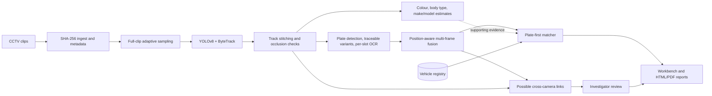

# Vehicle-Tracer

Vehicle-Tracer turns CCTV clips into explainable vehicle evidence. It tracks vehicles, recovers plate characters across frames, compares readable plates with a registry, and proposes cross-camera links for an investigator to review.

It never invents an unreadable plate character. When plate evidence is insufficient, it returns **No confident match** and explains why.

Results are investigative leads. A result does not establish a vehicle's or owner's identity and must be verified independently.

## Architecture



| Layer | Technology |
| --- | --- |
| API | FastAPI, Pydantic v2, Server-Sent Events |
| Storage | SQLite in WAL mode through SQLAlchemy 2, swappable with `DATABASE_URL` |
| Detection and tracking | YOLOv8s on GPU/MPS or YOLOv8n on CPU, ByteTrack, geometric and visual track stitching |
| Plate OCR | FastALPR ONNX models, with automatic EasyOCR fallback |
| Attributes and Re-ID | OpenCLIP ViT-B-32, CIELAB colour analysis, HSV histograms |
| Reports | Jinja2 HTML, WeasyPrint PDF, with automatic ReportLab fallback |
| Frontend | React 18, TypeScript, Vite, Tailwind CSS |

## Quick start

Requires Python 3.10+ and Node 20+.

```bash
cd backend
python3 -m venv .venv
.venv/bin/pip install -r requirements.txt
.venv/bin/python scripts/download_models.py
.venv/bin/uvicorn app.main:app --host 127.0.0.1 --port 8000
```

In a second terminal:

```bash
cd frontend
npm ci
npm run dev
```

Open <http://127.0.0.1:5173>.

`download_models.py` needs internet access once and fetches roughly 700 MB. The app never downloads weights at startup. If required weights are missing, analysis stops with the exact install command instead of producing substitute output. If only OpenCLIP is missing, the app runs and shows that make/model and fine body type are limited.

Load the labelled synthetic demo in a third terminal while the API is running:

```bash
cd backend
.venv/bin/python scripts/generate_demo_clip.py
.venv/bin/python scripts/create_demo_case.py
```

### Synthetic demo walkthrough

Every demo frame has a burned-in `SYNTHETIC TEST FIXTURE` banner, and each clip has ground truth in `demo_clips/synthetic_manifest.json`.

| Camera | What it demonstrates | Expected outcome |
| --- | --- | --- |
| A Gate | Last three characters covered, and two registry plates still fit | Ambiguous |
| B Junction | First three characters covered | Plate-supported partial shortlist |
| C Depot | Ends covered in turn, and one middle character never visible | `?` preserved, plate-supported |
| D Ring Road | No capture time | Link shows temporal validation unavailable |
| E Toll | Clear plate that is not in the registry | Genuine no match |
| F Car Park | Plate too blurred to read | Unreadable, no characters invented |

### Plate formats

Each camera has an explicit plate format: **Latin A-Z/0-9**, **India RTO/BH**, **UK**, or **Non-Latin, digits only**. The format limits which registry rows can be compared. It never fills in a character.

The OCR alphabet is `A-Z` and `0-9`. For Thai, Arabic or other non-Latin plates, choose **Non-Latin, digits only**. Letters stay unknown, and only the longest numeric block is used.

## Image evidence

For each plate read, the pipeline keeps a lossless, read-only raw crop and creates labelled derivatives: perspective correction when four reliable corners exist, grayscale + CLAHE, denoised, restrained unsharp mask, and 2x and 4x interpolation.

OCR runs on all views as a batch and keeps each slot's character probabilities. A character that appears only in processed views is marked as unsupported by source pixels and stays `?` unless another frame's raw crop supports it. Generative super-resolution is deliberately not used.

Uploaded evidence is hashed and made read-only, and its hash is verified again before every analysis. Each run writes to a new artifact folder.

## Plate fusion

Reads are cleaned, seeded from the frame most corroborated by other frames, and aligned with semi-global Needleman-Wunsch. Reads that do not align are rejected with a reason. Each slot keeps the source frame, character and confidence of every vote.

$$w_f = \text{ocr\_conf}_{f,i} \times \text{norm\_sharpness}_f \times \text{norm\_plate\_area}_f$$

$$\text{conf}_i = P_i(c) \times \Bigl(1 - \prod_{f \in \text{support}(c)} (1 - \text{ocr\_conf}_{f,i})\Bigr)$$

A slot is emitted as `?`, with the reason stored, when any of these is true:

- Fused confidence is below `0.55`, or a single frame supports it below `0.78`.
- Repeated frames disagree on the character.
- The character appears only after image processing.
- Reads disagree about the plate's length, so its position is unreliable.
- The position was seen in too few frames compared with its neighbours.

A multi-frame stack is shown and voted on, but it never counts as an independent frame.

## Matching

Plate evidence ranks vehicles first. Colour, body type and make/model only support a plate-based result. If OCR dropped a covered character, a short read can be compared with one or two *unknown* slots inserted, at a small penalty.

$$S_\text{plate} = \text{clamp}\Bigl(\frac{\sum \text{contributions}}{\sum c}\Bigr) \times \gamma, \qquad \gamma = \frac{\text{known chars}}{\text{plate length}}$$

A vehicle is promoted only when every gate passes:

| Gate | Threshold |
| --- | --- |
| Readable plate characters | at least 5 |
| Characters agreeing with the registry plate | at least 5 |
| Exact character matches | at least 4 |
| Plate agreement | at least 0.70 |
| High-confidence contradictions | at most 1, and at most 15% of readable characters |
| Match score | at least 45 |
| Gap to the next plate | score gap at least 5 and plate gap at least 0.02 |

The **match score is an uncalibrated ranking value, not a probability**. It should not be read as a likelihood of identity until it is calibrated against labelled examples.

## Cross-camera links

The system only proposes links. A proposal needs compatible plate characters plus independent corroboration:

- At least 5 consistent exact characters, with visual similarity or a plausible capture time.
- At least 4 consistent exact characters, with supporting visual similarity.

Colour, body type, model and visual similarity alone never create a link. Plate contradictions, incompatible plate formats, overlapping sightings and impossible travel speed block a link. Missing capture time is shown as **not validated**. Plates are presented as unified only after an investigator confirms the link.

## Evaluation

```bash
cd backend
.venv/bin/python -m pytest
.venv/bin/python scripts/evaluate_matcher.py --seed 7
.venv/bin/python scripts/evaluate_pipeline.py --output ../docs/synthetic_pipeline_evaluation.json
```

`evaluate_pipeline.py` renders labelled synthetic videos and runs them through the real detector, tracker, OCR, fusion, matcher and link logic. The set has 66 single-sighting cases (clear, partial, moving occlusion, ambiguous, unreadable and out-of-registry) plus 20 cross-camera sightings. Decision thresholds were not changed for this evaluation. Earlier seeds were used to find bugs, and the table reports the final unseen seed, `20261127`.

| Metric | Result |
| --- | ---: |
| Top-1 accuracy (46 rankable cases) | 93.5% |
| Top-5 recall | 97.8% |
| MRR | 0.953 |
| No-match precision | 85.7% |
| No-match recall | 100% |
| Promoted results | 31, with 0 wrong |
| Emitted character precision | 99.1% (6 wrong of 642) |
| Characters emitted on covered positions | 2 |
| Cross-camera link precision | 80% (8 of 10 proposals) |
| Cross-camera link recall | 80% (8 of 10 true pairs) |

Full results are in [`docs/synthetic_pipeline_evaluation.json`](docs/synthetic_pipeline_evaluation.json).

**These figures describe one synthetic fixture set, not real-world accuracy.** The fixtures reuse one recoloured vehicle photo, which makes visual re-identification unusually hard and plate rendering unusually clean. Recolourings that the stock detector does not see as a vehicle are excluded. The result still shows real failure modes: OCR occasionally emits a character on a covered position, and false link proposals occur, which is why every link requires investigator review.

## Known limitations

- Matching accuracy has not been validated against a labelled real-world dataset, and no model was retrained on project data.
- The default registry is synthetic and contains only India RTO/BH-style plates. Real UK or Thai footage is expected to return no registry match until a matching registry is uploaded.
- Plate format must be set by the operator, because automatic Thai-script detection was not reliable in testing.
- OCR can be confidently wrong on degraded or partly covered plates. Multi-frame checks reduce this but do not eliminate it.
- YOLOv8 uses COCO classes, so auto-rickshaws depend on the OpenCLIP refinement.
- Colour, body type and make/model are approximate estimates and are sometimes wrong.
- The EasyOCR fallback is available only if its weights are already installed.
- Earlier analysis runs keep their raw crops, so repeated analysis uses more disk space.
- The Docker setup has not been run, and WeasyPrint needs native Pango libraries. Without them, PDFs use the ReportLab layout.
- The API has no authentication. Add access control before any deployment beyond a local machine.

## Licensing

Ultralytics YOLO is distributed under AGPL-3.0 unless you hold an Ultralytics Enterprise License. Review this and the model licenses before distributing or commercializing the project.

## API

| Method | Endpoint | Purpose |
| --- | --- | --- |
| GET | `/api/health` | System, model, device and registry status |
| POST, GET | `/api/cases` | Create or list cases |
| GET | `/api/cases/{id}` | Case detail and outcome summary |
| POST | `/api/cases/{id}/clips` | Upload clips |
| PATCH | `/api/cases/{id}/clips/{clip_id}` | Update capture time, timezone, location or plate format |
| POST | `/api/cases/{id}/analyze` | Start the pipeline |
| GET | `/api/cases/{id}/progress` | Live SSE progress |
| GET | `/api/cases/{id}/vehicles[/{vehicle_id}]` | Tracks and evidence |
| POST | `/api/cases/{id}/vehicles/{vehicle_id}/override` | Investigator override and re-rank |
| POST | `/api/cases/{id}/entities/{entity_id}/review` | Confirm, reject or reopen a possible link |
| GET | `/api/cases/{id}/report/html`, `/report/pdf?appendix=true&clip_id=` | Case or per-clip forensic reports |
| GET | `/api/registry` | Search the registry |
| POST | `/api/registry/upload` | Import CSV or JSON |
| POST | `/api/registry/match-test` | Matcher sandbox |
