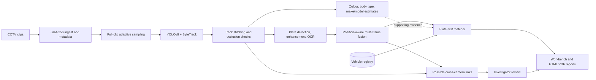

# Vehicle-Tracer

Vehicle-Tracer turns CCTV clips into explainable vehicle evidence. It tracks vehicles, recovers plate characters across frames, compares readable plates with a registry, and proposes cross-camera links for an investigator to review.

It never invents an unreadable plate character. When plate evidence is insufficient, it returns **No confident match** and explains why.

Results are investigative leads. A result does not establish a vehicle's or owner's identity and must be verified independently.

## Architecture



| Layer | Technology |
| --- | --- |
| API | FastAPI, Pydantic v2, Server-Sent Events |
| Storage | SQLite in WAL mode through SQLAlchemy 2, swappable with `DATABASE_URL` |
| Detection and tracking | YOLOv8s on GPU/MPS or YOLOv8n on CPU, ByteTrack, geometric and visual track stitching |
| Plate OCR | FastALPR ONNX models, with automatic EasyOCR fallback |
| Attributes and Re-ID | OpenCLIP ViT-B-32, CIELAB colour analysis, HSV histograms |
| Reports | Jinja2 HTML, WeasyPrint PDF, with automatic ReportLab fallback |
| Frontend | React 18, TypeScript, Vite, Tailwind CSS |

## Quick start

Requires Python 3.10+ and Node 20+.

```bash
cd backend
python3 -m venv .venv
.venv/bin/pip install -r requirements.txt
.venv/bin/python scripts/download_models.py
.venv/bin/python scripts/generate_demo_clip.py
.venv/bin/uvicorn app.main:app --host 127.0.0.1 --port 8000
```

In a second terminal:

```bash
cd frontend
npm ci
npm run dev
```

Open <http://127.0.0.1:5173>. The first model download needs internet access and is roughly 700 MB. Later runs work offline.

### Live demo

1. Create a case and ingest `backend/demo_clips/camera_a_gate.mp4` and `camera_b_junction.mp4`. Give each a capture time.
2. Select **Run analysis**.
3. Camera A reads `MH14GT7`, which fits more than one registry plate, so it stays **Ambiguous**.
4. Camera B reads `4GT7319`, which is a plausible partial-plate candidate.
5. Open **Cross-camera trace**, compare the evidence, and confirm or reject the possible link.
6. In **Registry and sandbox**, use the presets to see a full plate, an ambiguous plate, too few characters, attributes only, and a genuine no-match.
7. Export the HTML or PDF report.

### Non-Latin plates

The OCR alphabet is `A-Z` and `0-9`. If a clip contains Thai, Arabic or other non-Latin plate letters, set its **Plate script** to **Non-Latin, digits only** and re-run analysis. Letters are withheld as unknown, and only the numeric block is used.

## Plate fusion

Reads are cleaned, seeded from the frame most corroborated by other frames, and aligned with semi-global Needleman-Wunsch. Reads that do not align are rejected with a reason. Each slot keeps the source frame, character and confidence of every vote.

$$w_f = \text{ocr\_conf}_{f,i} \times \text{norm\_sharpness}_f \times \text{norm\_plate\_area}_f$$

$$\text{conf}_i = P_i(c) \times \Bigl(1 - \prod_{f \in \text{support}(c)} (1 - \text{ocr\_conf}_{f,i})\Bigr)$$

A slot is emitted as `?` when $\text{conf}_i < 0.55$, or when a single frame supports it below `0.78`. A multi-frame stack is shown and voted on, but it never counts as an independent frame. Generative super-resolution is deliberately not used because it can invent characters.

## Matching

Plate evidence ranks vehicles first. Colour, body type and make/model only support a plate-based result.

$$S_\text{plate} = \text{clamp}\Bigl(\frac{\sum \text{contributions}}{\sum c}\Bigr) \times \gamma, \qquad \gamma = \frac{\text{known chars}}{\text{plate length}}$$

A vehicle is promoted only when every gate passes:

| Gate | Threshold |
| --- | --- |
| Readable plate characters | at least 5 |
| Characters agreeing with the registry plate | at least 5 |
| Exact character matches | at least 4 |
| Plate agreement | at least 0.70 |
| High-confidence contradictions | at most 1, and at most 15% of readable characters |
| Match score | at least 45 |
| Gap to the next plate | score gap at least 5 and plate gap at least 0.02 |

The **match score is an uncalibrated ranking value, not a probability**. It should not be read as a likelihood of identity until it is calibrated against labelled examples.

## Cross-camera links

The system only proposes links. A proposal needs one of these:

- At least 5 consistent exact plate characters.
- At least 4 consistent exact plate characters plus supporting visual similarity.
- Strong visual similarity plus a plausible capture time on both clips.

Colour, body type and model can never create a link. High-confidence plate contradictions block a link. Missing capture time is shown as **not validated**. Plates are presented as unified only after an investigator confirms the link.

## Evaluation

```bash
cd backend
.venv/bin/python -m pytest
.venv/bin/python scripts/evaluate_matcher.py --seed 7
```

The benchmark uses **simulated OCR evidence** against the synthetic registry. It checks matcher logic, including whether out-of-registry vehicles are rejected. It does not measure real-world detection, OCR or identification accuracy.

## Known limitations

- Matching accuracy has not been validated against a labelled real-world dataset, and no model was retrained on project data.
- The default registry is synthetic, so real footage is expected to produce no true registry matches until a real registry is uploaded.
- Plate script must be set by the operator, because automatic Thai-script detection was not reliable in testing.
- YOLOv8 uses COCO classes, so auto-rickshaws depend on the OpenCLIP refinement.
- Colour, body type and make/model are approximate estimates.
- OCR can be overconfident on heavily degraded plates.
- The API has no authentication. Add access control before any deployment beyond a local machine.

## Licensing

Ultralytics YOLO is distributed under AGPL-3.0 unless you hold an Ultralytics Enterprise License. Review this and the model licenses before distributing or commercializing the project.

## API

| Method | Endpoint | Purpose |
| --- | --- | --- |
| GET | `/api/health` | System, model, device and registry status |
| POST, GET | `/api/cases` | Create or list cases |
| GET | `/api/cases/{id}` | Case detail and outcome summary |
| POST | `/api/cases/{id}/clips` | Upload clips |
| PATCH | `/api/cases/{id}/clips/{clip_id}` | Update capture time, location or plate script |
| POST | `/api/cases/{id}/analyze` | Start the pipeline |
| GET | `/api/cases/{id}/progress` | Live SSE progress |
| GET | `/api/cases/{id}/vehicles[/{vehicle_id}]` | Tracks and evidence |
| POST | `/api/cases/{id}/vehicles/{vehicle_id}/override` | Investigator override and re-rank |
| POST | `/api/cases/{id}/entities/{entity_id}/review` | Confirm, reject or reopen a possible link |
| GET | `/api/cases/{id}/report/html`, `/report/pdf?appendix=true` | Forensic reports |
| GET | `/api/registry` | Search the registry |
| POST | `/api/registry/upload` | Import CSV or JSON |
| POST | `/api/registry/match-test` | Matcher sandbox |
